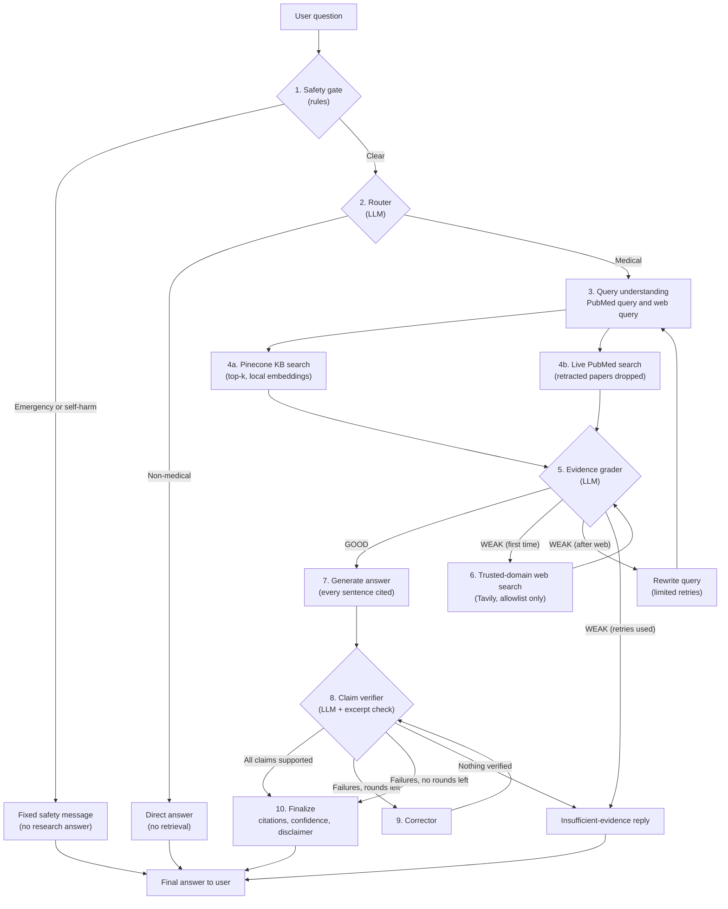
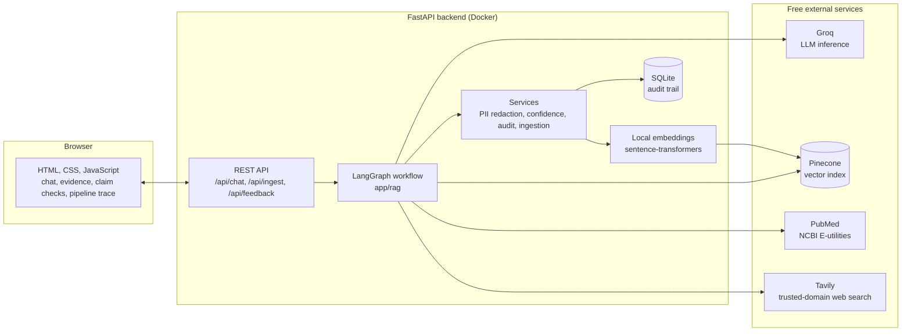

# MedVerify AI

**An agentic RAG assistant that answers medical research questions from trusted literature, cites every statement, and fact-checks its own answer before showing it.**

MedVerify AI retrieves evidence from a private knowledge base, live PubMed and an allowlist of trusted health websites. It generates an answer in which every sentence carries a citation. It then splits that answer into individual claims and verifies each one against its cited source. Unsupported claims are corrected or removed, and the user can inspect the full evidence trail.

> **Medical disclaimer.** MedVerify AI summarises published research. It is not a medical device and is not a substitute for professional medical advice, diagnosis or treatment. Always consult a qualified clinician about your own health. In an emergency, contact your local emergency services.

---

## Table of contents

- [Features](#features)
- [Architecture](#architecture)
- [Medical-domain safeguards](#medical-domain-safeguards)
- [Tech stack](#tech-stack)
- [Project structure](#project-structure)
- [Getting started](#getting-started)
- [Seeding the knowledge base](#seeding-the-knowledge-base)
- [Using the app](#using-the-app)
- [API reference](#api-reference)
- [Configuration](#configuration)
- [Testing](#testing)
- [Troubleshooting](#troubleshooting)
- [Limitations](#limitations)

---

## Features

- **Agentic workflow** built with LangGraph: safety gate, routing, retrieval, evidence grading, generation, claim verification and correction.
- **Multi-source evidence:** Pinecone knowledge base, live PubMed (NCBI E-utilities) and a trusted-domain web fallback.
- **Claim-level verification:** every statement is checked against its cited passage and labelled `SUPPORTED`, `UNSUPPORTED` or `CONTRADICTED`. A deterministic check confirms that quoted excerpts really exist in the source.
- **Self-correction loop:** failing claims are rewritten or removed, then re-verified.
- **Transparency UI:** evidence panel, per-claim verdicts and a step-by-step pipeline trace for every answer.
- **Computed confidence:** High, Moderate, Low or Insufficient, derived from verification results and evidence quality, not guessed by the LLM.
- **Strict structured outputs:** every LLM step that returns JSON uses a JSON schema, with retries and a safe fallback.
- **Dockerised** FastAPI backend with a plain HTML, CSS and JavaScript frontend.
- **Free to run:** Groq, Pinecone Starter, Tavily free tier, PubMed and local embeddings.

---

## Architecture

### Agentic RAG workflow



### System components



### How a question flows

| Step | What happens |
|---|---|
| 1. Safety gate | Rule-based detection of emergencies, self-harm and personal-treatment questions. Emergencies get a fixed message and no research answer. |
| 2. Router | An LLM decides whether the message is a medical question or general conversation. |
| 3. Query understanding | The question is converted into a PubMed query and a web query. |
| 4. Retrieval | Pinecone knowledge-base search and live PubMed search run, with retracted papers excluded. |
| 5. Evidence grading | Sources are scored for relevance and ranked by study type. The result is GOOD or WEAK. |
| 6. Web fallback | If evidence is weak, Tavily searches only allowlisted domains such as nih.gov, who.int, cdc.gov and fda.gov. |
| 7. Generation | The answer may use only the numbered evidence and must cite it. |
| 8. Claim verification | Each claim is checked against its cited passage. Supported claims need an excerpt that exists in the source. |
| 9. Correction | Failing claims are rewritten or removed, then re-verified for a limited number of rounds. |
| 10. Finalize | Citations are numbered, source disagreements are flagged, confidence is computed and a disclaimer is attached. |

---

## Medical-domain safeguards

1. **Source allowlist.** Web search is limited to trusted health and research domains. Tavily is called with `include_domains`, and results are re-checked.
2. **Evidence hierarchy.** Meta-analyses, systematic reviews and guidelines rank above randomised trials, then observational studies, then case reports and opinion.
3. **Mandatory citations.** A statement without a valid citation fails verification.
4. **Verification is a hard gate.** Unverified claims never reach the final answer.
5. **Contradictions are surfaced.** If sources disagree, the answer says so.
6. **Retractions and age.** Retracted papers are excluded, and sources older than the configured threshold are flagged.
7. **Computed confidence.** Based on verification pass rate, best study type, number of sources and conflicts.
8. **Scope control.** Emergencies, self-harm and personal-dosing questions are handled by fixed rules, not by the LLM.
9. **Privacy.** Emails, phone numbers and similar identifiers are redacted before logging or sending queries to external APIs.
10. **Auditability.** Each answer's evidence, claim verdicts, models used and pipeline trace are logged to SQLite.

---

## Tech stack

| Layer | Technology |
|---|---|
| Orchestration | LangGraph |
| Backend | FastAPI, Pydantic, Uvicorn |
| LLM | Groq (`openai/gpt-oss-120b` and `openai/gpt-oss-20b` by default) |
| Embeddings | `sentence-transformers` (local, free) |
| Vector database | Pinecone Starter (free) |
| Literature | PubMed via NCBI E-utilities |
| Web fallback | Tavily (free tier, domain allowlist) |
| Frontend | HTML, CSS, JavaScript (no framework) |
| Audit store | SQLite |
| Packaging | Docker, Docker Compose |
| Tests | pytest |

---

## Project structure

```text
medverify-ai/
├── app/
│   ├── main.py                  # FastAPI app and static file serving
│   ├── api/
│   │   └── routes.py            # chat, feedback and ingestion endpoints
│   ├── core/
│   │   ├── config.py            # environment-based settings
│   │   ├── safety_rules.py      # emergency and self-harm detection
│   │   └── source_allowlist.py  # trusted domains and study-type tiers
│   ├── rag/
│   │   ├── state.py             # LangGraph state
│   │   ├── schemas.py           # JSON schemas for LLM outputs
│   │   ├── nodes.py             # workflow nodes
│   │   └── workflow.py          # graph wiring
│   └── services/
│       ├── llm.py               # Groq client with retries and structured outputs
│       ├── pubmed.py            # PubMed search and parsing
│       ├── vectorstore.py       # Pinecone and embeddings
│       ├── ingestion.py         # chunking and document loading
│       ├── web_search.py        # Tavily with domain allowlist
│       ├── confidence.py        # confidence scoring
│       ├── pii.py               # PII redaction
│       └── audit.py             # SQLite audit log
├── scripts/
│   ├── ingest_seed_kb.py        # seed the knowledge base from PubMed
│   └── test_retrieval.py        # inspect retrieval results
├── static/                      # CSS and JavaScript
├── templates/index.html         # frontend page
├── tests/test_basic.py          # offline unit tests
├── Dockerfile
├── docker-compose.yml
├── requirements.txt
└── .env.example
```

---

## Getting started

### 1. Get free API keys

| Service | Where | Used for |
|---|---|---|
| Groq | console.groq.com | LLM inference |
| Pinecone | app.pinecone.io (Starter plan) | Vector database |
| Tavily | app.tavily.com | Trusted web search |
| NCBI (optional) | ncbi.nlm.nih.gov/account | Higher PubMed rate limit |

### 2. Configure

```bash
cp .env.example .env
```

Edit `.env` and fill in your keys. Never commit this file.

### 3a. Run with Docker (recommended)

```bash
docker compose up --build -d
docker compose logs -f
```

Open <http://localhost:8000>. If port 8000 is taken, change the mapping in `docker-compose.yml`, for example `"8080:8000"`.

### 3b. Run locally without Docker

Requires Python 3.10 to 3.12.

```bash
python -m venv venv
source venv/bin/activate          # Windows: venv\Scripts\activate
pip install -r requirements.txt
python run.py
```

The first start downloads the embedding model (about 90 MB).

### Check that it is healthy

```bash
curl http://localhost:8000/api/health
```

Expected: `{"status":"ok","groq":true,"pinecone":true,"tavily":true}`. A `false` value means that key is missing in `.env`.

---

## Seeding the knowledge base

Seeding is optional, since live PubMed search works without it, but it makes answers faster and richer. It loads systematic reviews, meta-analyses, randomised trials and guidelines into Pinecone.

```bash
# Default topics (diabetes, hypertension, statins, asthma, vitamin D,
# COVID-19 vaccines, antibiotic resistance, migraine, mammography, depression)
docker compose exec medverify python -m scripts.ingest_seed_kb

# Your own topics
docker compose exec medverify python -m scripts.ingest_seed_kb "gout treatment" "migraine prevention"
```

Inspect what retrieval returns for a query, without involving the LLM:

```bash
docker compose exec -T medverify python - "Does metformin reduce cardiovascular risk?" < scripts/test_retrieval.py
```

You can also upload your own PDF, DOCX, TXT or MD files from the **Admin** panel in the UI, using your `ADMIN_API_KEY`.

---

## Using the app

Ask a medical research question, for example:

> Does metformin reduce cardiovascular risk in type 2 diabetes?

The right-hand panel explains the answer:

- **Evidence:** every cited source with study type, year, journal, PMID or DOI and the supporting passage.
- **Claim checks:** each statement with its verdict, including claims that were removed.
- **Pipeline:** the full path the agent took, with timing.

Things worth trying:

| Input | Expected behaviour |
|---|---|
| A question matching a seeded topic | Answer with knowledge-base and PubMed sources |
| A medical question outside the seeded topics | Live PubMed and possibly trusted web fallback |
| `Hello` | Direct reply, no retrieval |
| `I have chest pain and can't breathe` | Emergency message, no research answer |
| `Should I stop taking my statin?` | General research answer with a personal-advice notice |
| A fictional or nonsense medical question | Transparent "insufficient evidence" reply |

---

## API reference

Interactive documentation is available at `/docs`.

| Method | Endpoint | Description |
|---|---|---|
| `GET` | `/api/health` | Health and configuration check |
| `POST` | `/api/chat` | Ask a question. Returns the answer, citations, claim verdicts, confidence, trace and safety flags |
| `POST` | `/api/feedback` | Submit thumbs up or down for an answer |
| `POST` | `/api/ingest` | Admin only. Upload a document into the knowledge base |
| `POST` | `/api/ingest/pubmed` | Admin only. Import papers by PubMed query |

Example:

```bash
curl -X POST http://localhost:8000/api/chat \
  -H "Content-Type: application/json" \
  -d '{"question": "Does vitamin D supplementation prevent fractures?"}'
```

Admin endpoints require the header `X-Admin-Key: <ADMIN_API_KEY>`.

---

## Configuration

Set these in `.env`.

| Variable | Description | Default |
|---|---|---|
| `GROQ_API_KEY` | Groq API key | none |
| `GROQ_FAST_MODEL` | Model for routing, grading and query rewriting | `llama-3.1-8b-instant` in `.env.example` |
| `GROQ_STRONG_MODEL` | Model for generation and verification | `llama-3.3-70b-versatile` in `.env.example` |
| `TAVILY_API_KEY` | Tavily API key | none |
| `PINECONE_API_KEY` | Pinecone API key | none |
| `PINECONE_INDEX` | Index name, created automatically | `medverify-kb` |
| `PINECONE_NAMESPACE` | Namespace inside the index | `medical-literature` |
| `EMBEDDING_MODEL` | Local sentence-transformers model | `sentence-transformers/all-MiniLM-L6-v2` |
| `NCBI_EMAIL` | Contact email sent to NCBI | `you@example.com` |
| `NCBI_API_KEY` | Optional, raises PubMed rate limit | none |
| `ADMIN_API_KEY` | Key for ingestion endpoints | `change-me...` |
| `RATE_LIMIT_PER_MIN` | Requests per minute per IP | `20` |
| `AUDIT_DB_PATH` | SQLite audit database path | `data/audit.db` |

Groq model availability varies by account and changes over time. List the models your key can use at console.groq.com/docs/models and set the two model variables to names from that list. This project has been run with `openai/gpt-oss-20b` as the fast model and `openai/gpt-oss-120b` as the strong model.

Workflow limits such as the number of retrieved passages, correction rounds and evidence age are defined in `app/core/config.py`.

If you switch to an embedding model with a different vector size, use a **new** `PINECONE_INDEX` name, because an index's dimension is fixed when it is created.

---

## Testing

Offline unit tests need no API keys:

```bash
pytest -q
# or inside the container
docker compose exec medverify pytest -q
```

They cover safety rules, PII redaction, the source allowlist, study-type tiers, chunking, excerpt grounding, claim splitting and confidence scoring.

---

## Troubleshooting

| Problem | Likely cause and fix |
|---|---|
| `Bind for 0.0.0.0:8000 failed: port is already allocated` | Another process uses port 8000. Change the mapping to `"8080:8000"` or stop the other process. |
| Docker build fails with `BrokenPipeError` during pip install | An unstable download. Rebuild with `docker compose build`, and the pip cache will resume. |
| `Groq error 404 ... model_not_found` | The model is unavailable to your key. Pick a model from your account's list and update `.env`. |
| `Groq error 400 ... json_validate_failed` | Use JSON-schema structured outputs as implemented in `app/services/llm.py`. Prefer `gpt-oss-120b` for strict mode. |
| `429` or rate-limit messages | Free-tier limits. Wait a minute, or lower the number of evidence passages in `config.py`. |
| Request hangs on the first question | The first run loads the embedding model and creates the Pinecone index, which can take a minute or two. |
| Changes to code have no effect | The code is baked into the image. Run `docker compose build` and `docker compose up -d --force-recreate`. Changes to `.env` only need the recreate step. |

---

## Limitations

- **Not a medical device.** The claim verifier is itself LLM-based. Mandatory citations, excerpt checks and refusal on weak evidence reduce errors a lot but cannot eliminate them. Have a clinician review anything used for real decisions.
- **Abstracts only.** PubMed provides abstracts, not full text, so details found only in the full paper are not seen.
- **Rule-based emergency detection** is conservative and keyword-based. It can block some legitimate research phrasing and can miss unusual wording. It is not a triage tool.
- **Free-tier constraints.** Each question makes several LLM calls, so Groq rate limits apply. Terms and limits of all free services can change.
- **Latency.** A full run with verification and correction can take over a minute.

---
